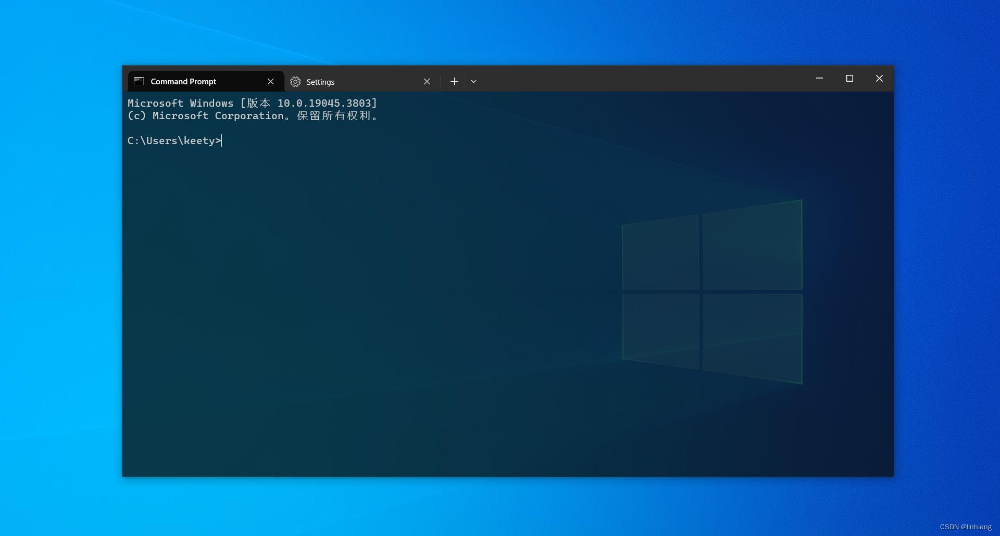

# 2.7 Terminal Emulators

In the previous section, we followed the journey of text as it traveled from `stdout` through the operating system toward the user's terminal.

One important question remains:

> **What actually displays the text on the screen?**

The answer is **the terminal emulator**.

Every time you open a terminal window on your desktop, you are launching a terminal emulator. It is the application responsible for receiving a stream of characters from the operating system and rendering them as visible text inside a graphical window.

Our text editor will run _inside_ a terminal emulator. Understanding its role is therefore essential before we begin exploring the Unix terminal system in the next chapter.

---

## What Is a Terminal Emulator?

A **terminal emulator** is a program that simulates the behavior of a traditional computer terminal within a graphical operating system.

Instead of drawing its own user interface using buttons, menus, and windows, a terminal application communicates by sending characters and control sequences. The terminal emulator interprets those bytes and updates the display accordingly.

Conceptually, the process is straightforward.

```text
Application

    │
    ▼

Character Stream

    │
    ▼

Terminal Emulator

    │
    ▼

Rendered Window
```

The application never draws pixels directly.

Instead, it sends instructions in the form of characters and control sequences. The terminal emulator converts those instructions into a visible interface.

For example, when a program writes:

```c
printf("Hello, World!\n");
```

the program has merely produced a sequence of bytes.

The terminal emulator receives those bytes and displays:

```text
Hello, World!
```

From the user's perspective, the program appears to have written directly onto the screen. In reality, the terminal emulator performed the rendering.

---

## Why Does a Terminal Emulator Exist?

Modern operating systems use graphical desktop environments.

Applications such as web browsers, file managers, and text editors usually create their own windows and draw their own graphical interfaces.

Terminal programs work differently.

They were originally designed to communicate with physical text terminals long before graphical desktop environments existed. Modern computers no longer use those physical devices, but millions of command-line programs still expect to communicate with one.

Rather than changing every existing program, operating systems provide terminal emulators that imitate the behavior of those earlier terminals.

As a result, decades-old command-line software can continue to run on modern graphical desktops without modification.

A terminal emulator therefore serves as a bridge between two different worlds:

- graphical desktop environments, and
- text-based terminal applications.

It provides a window on the desktop while preserving the behavior expected by traditional terminal software.

---

## The Terminal Emulator Is Not the Application

One of the most common misconceptions among beginners is believing that the terminal emulator _is_ the program they are running.

Suppose you type:

```bash
ls
```

The screen displays a list of files.

It is tempting to think that the terminal emulator executed the `ls` command.

It did not.

Instead, the sequence of events is roughly:

```text
User

    │
types "ls"

    ▼

Shell

    │
starts

    ▼

ls Program

    │
writes output

    ▼

Terminal Emulator

    │
renders text

    ▼

Screen
```

Each component has a separate responsibility.

- The **shell** interprets the command you typed.
- The **operating system** starts the requested program.
- The **program** produces output.
- The **terminal emulator** displays that output.

The terminal emulator is responsible only for communication and rendering. It does not execute shell commands itself.

This distinction becomes especially important when we begin writing our own editor. Our program will simply produce output; it will not concern itself with how that output is drawn on the screen.

---

## Interpreting Character Streams

A terminal emulator continuously receives a stream of bytes.

Some bytes represent ordinary printable characters.

For example,

```text
48 65 6C 6C 6F
```

may eventually become:

```text
Hello
```

However, not every byte represents visible text.

Some byte sequences are interpreted as **commands** that control the display.

For example, a sequence might mean:

- move the cursor,
- clear the screen,
- change the text color,
- hide the cursor, or
- switch to an alternate screen.

The application does not perform these actions itself.

Instead, it sends special byte sequences, and the terminal emulator interprets them according to established terminal conventions.

We will study these control sequences in detail in Chapter 4 when we introduce ANSI Escape Sequences.

For now, it is enough to understand that the terminal emulator is constantly interpreting an incoming stream of bytes—some representing text, others representing display instructions.

---

## Common Terminal Emulators

Many terminal emulators are available today. Although they differ in appearance, performance, and additional features, they all serve the same fundamental purpose: receiving character streams and rendering a terminal interface.

### GNOME Terminal


**GNOME Terminal** is the default terminal emulator for many Linux distributions that use the GNOME desktop environment.

It integrates closely with the desktop, supports multiple tabs, profiles, Unicode, colors, and modern terminal features, making it a common choice for Linux users.

---

### Windows Terminal



**Windows Terminal** is Microsoft's modern terminal application.

Unlike the older Windows Console, it supports multiple tabs, Unicode, customizable themes, GPU-accelerated rendering, and multiple command-line environments such as PowerShell, Command Prompt, and the Windows Subsystem for Linux (WSL).

---

### Alacritty


**Alacritty** is a lightweight terminal emulator focused on speed.

It uses GPU acceleration for rendering and intentionally keeps its feature set relatively small, leaving advanced functionality to external tools.

Many developers choose Alacritty because of its responsiveness.

---

### Kitty


**Kitty** is another GPU-accelerated terminal emulator.

In addition to high performance, it provides advanced capabilities such as image display, sophisticated window management, and an extended terminal protocol beyond traditional ANSI functionality.

---

### iTerm2


**iTerm2** is one of the most popular terminal emulators on macOS.

It offers features such as split panes, search, session restoration, extensive customization, and powerful automation while remaining compatible with standard terminal applications.

---

## Different Programs, Same Language

Although these terminal emulators are developed by different teams and run on different operating systems, they all understand the same basic terminal conventions.

That is why a terminal application written for Linux often runs correctly inside:

- GNOME Terminal,
- Alacritty,
- Kitty,
- Windows Terminal (through compatible environments), and
- iTerm2,

without requiring changes to its source code.

The application simply produces a stream of characters and terminal control sequences. As long as the terminal emulator understands those sequences, it can render the interface correctly.

This shared "language" between applications and terminal emulators is one of the reasons terminal software has remained remarkably portable for decades.

---

### Engineering Insight

A terminal emulator is best viewed as a specialized rendering engine rather than a command interpreter.

Its primary responsibility is to translate incoming character streams into a visual representation. The shell executes commands, the operating system manages processes, and applications generate output. By keeping these responsibilities separate, Unix-like systems allow each component to evolve independently while maintaining compatibility with existing software.

---

### Common Mistakes

**Confusing the shell with the terminal emulator**

The shell interprets commands and starts programs. The terminal emulator displays their input and output.

**Assuming the terminal emulator executes applications**

It does not. Applications are started by the operating system, typically at the request of a shell.

**Believing the terminal emulator draws whatever the application wants directly**

Applications send bytes and control sequences. The terminal emulator decides how to interpret and render them according to terminal standards.

**Thinking all terminal emulators are fundamentally different**

While they vary in features and performance, they all perform the same essential role: interpreting character streams and rendering a terminal interface.

---

## Summary

A terminal emulator is the graphical application that presents a text-based terminal on a modern desktop. Rather than executing commands itself, it receives a stream of characters and control sequences from terminal applications, interprets that stream, and renders the resulting interface inside a window.

This separation of responsibilities is fundamental to terminal programming. Applications produce output, the shell launches programs, the operating system manages communication, and the terminal emulator handles rendering.

In the next section, we will clarify the distinction between two terms that are often used interchangeably: the **console** and the **terminal**. Understanding their historical origins will help explain why both terms remain in use today.
